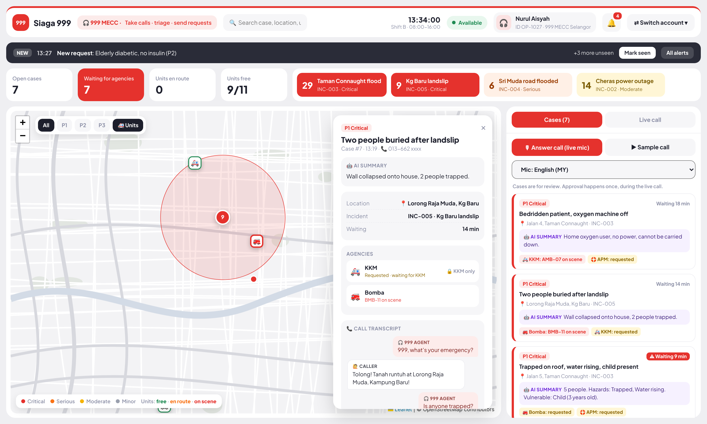
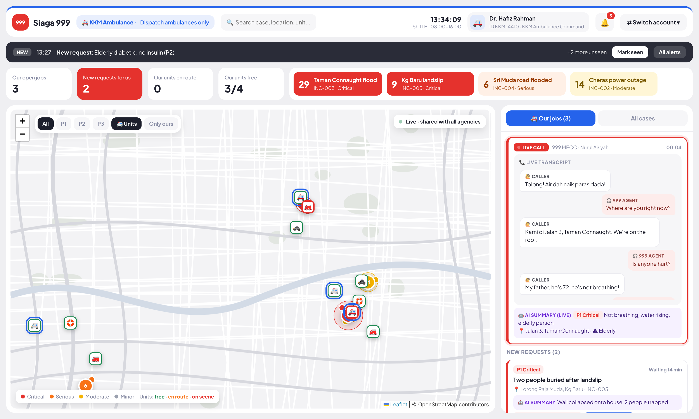

# Siaga 999 · Multi-agency disaster response

Hackathon prototype for the **Disaster Recovery** track (Sunway University, Nov 2026).

During a large disaster everyone calls 999 at once. Siaga 999 lets the 999 call-taker, KKM ambulance, Bomba, APM, PDRM and the State Disaster Command (JPBN) work from **one shared live picture**:

- **Live call transcript** as a conversation (999 Agent / Caller), from the browser mic or a sample call
- **AI triage** (P1 to P4, reason, location, agencies, nearest units). The AI pre-selects every decision; a human approves once during the call or changes it manually
- **Every department sees the same data live**: cases, the live call, units moving on the real map with ETA
- **Each department acts only on its own work**: agencies accept jobs and dispatch their own units (AI recommends the nearest one)
- Real road routes and driving ETA (OSRM), address lookup (OpenStreetMap Nominatim), OpenStreetMap / CARTO map tiles




## Run it

It's a single static file, so there's nothing to install.

```bash
python -m http.server 8000
# open http://localhost:8000 in Chrome or Edge
```

Open several tabs and use **Switch account** in each one (999 MECC, KKM, Bomba, APM, PDRM, Command). The tabs stay in sync.

Use Chrome or Edge with internet for the live mic, real map tiles, routing and address lookup. Without internet, a drawn backup map and estimated ETAs are used.

## Demo (3 minutes)

1. Tab 1 **999 MECC**: press *Sample call* (or *Answer call (live mic)*). Every other department sees the live transcript and AI summary as the call happens.
2. When the call ends, the AI decision appears. Press **Approve & send**, or **Change manually**.
3. Tab 2 **KKM**: the request appears in *Our jobs* with the AI's recommended ambulance. Press **Approve dispatch**.
4. Tab 3 **Command**: watch the ambulance drive to the case with a live ETA. KKM marks **Job done** on arrival.

## Project layout

```
index.html               Built single-file app (deploy this)
src/siaga999_multi.html  App source (UI, shared state, AI flow, map)
src/triage_rules.js      Rule-based triage: extraction, P1-P4 scoring, keyword overrides
src/build.py             Inlines Leaflet, fonts and rules into index.html
```

To rebuild after editing `src/`: `npm i leaflet@1.9.4 @fontsource/plus-jakarta-sans && python src/build.py`

## Limitations

- No backend: data is shared between tabs of one browser (localStorage + BroadcastChannel). Multi-device use needs a server.
- Accounts are hardcoded demo roles, with no real authentication.
- Triage is rule-based and only knows the phrases it was built for (English + some Bahasa Malaysia).
- Speaker labels in the live mic are set by the operator; the browser cannot tell voices apart.

**Hackathon prototype. Not a certified emergency system. Do not use it for real emergencies.**

MIT licence
